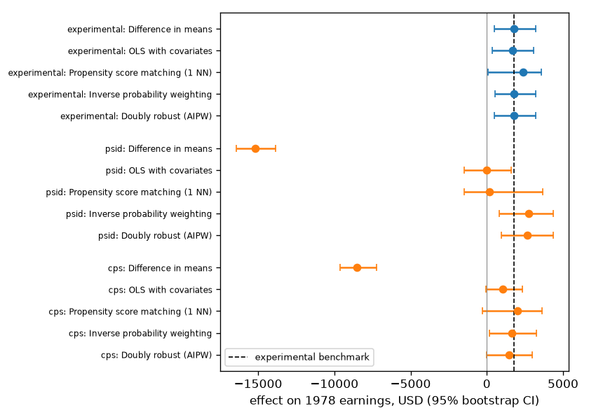
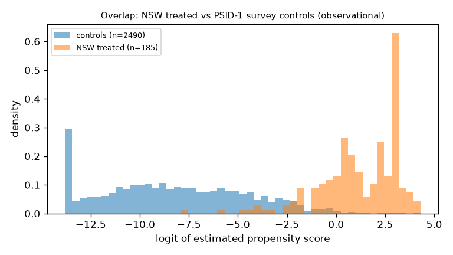
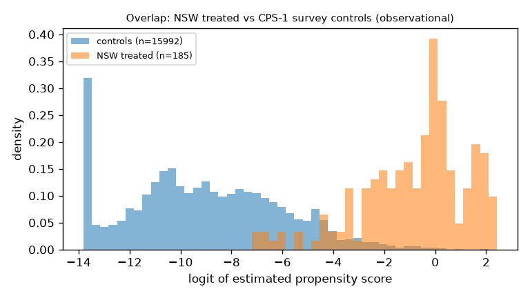

# LaLonde / NSW: observational estimators against the experimental benchmark

Generated by `python -m rie.report` from `causal/estimates.csv` and `causal/summary.json`. Do not edit by hand.

Outcome: earnings in 1978 (USD). Estimand: effect on the treated (ATT). Intervals: 95% percentile bootstrap, 500 resamples, seed 20261201. The bootstrap is joint: each resample draws the 185 NSW treated once and uses that draw in all three samples, with each control group drawn separately. That keeps the dependence between an observational estimate and the benchmark, so the interval for the bias (estimate minus benchmark) accounts for the uncertainty in the benchmark too.

**Experimental benchmark: 1 794 USD** (bootstrap CI 516 to 3 218; Welch t CI 474 to 3 115).

| Sample | Method | Estimate | 95% CI | Bias vs benchmark | 95% CI of bias |
|---|---|---:|---:|---:|---:|
| experimental | Difference in means | 1 794 | 516 to 3 218 | n/a (same data) |  |
| experimental | OLS with covariates | 1 671 | 376 to 3 048 | n/a (same data) |  |
| experimental | Propensity score matching (1 NN) | 2 376 | 60 to 3 556 | n/a (same data) |  |
| experimental | Inverse probability weighting | 1 785 | 549 to 3 226 | n/a (same data) |  |
| experimental | Doubly robust (AIPW) | 1 768 | 501 to 3 212 | n/a (same data) |  |
| psid | Difference in means | -15 205 | -16 433 to -13 838 | -16 999 | -17 866 to -16 122 |
| psid | OLS with covariates | 4 | -1 481 to 1 613 | -1 790 | -3 154 to -358 |
| psid | Propensity score matching (1 NN) | 170 | -1 503 to 3 674 | -1 625 | -3 104 to 1 724 |
| psid | Inverse probability weighting | 2 766 | 816 to 4 340 | 971 | -849 to 2 343 |
| psid | Doubly robust (AIPW) | 2 657 | 933 to 4 340 | 862 | -775 to 2 376 |
| cps | Difference in means | -8 498 | -9 613 to -7 221 | -10 292 | -10 923 to -9 643 |
| cps | OLS with covariates | 1 066 | -53 to 2 325 | -728 | -1 616 to 78 |
| cps | Propensity score matching (1 NN) | 2 006 | -290 to 3 639 | 212 | -2 117 to 1 477 |
| cps | Inverse probability weighting | 1 654 | 161 to 3 244 | -140 | -1 304 to 1 065 |
| cps | Doubly robust (AIPW) | 1 479 | -24 to 2 999 | -315 | -1 598 to 881 |

## Diagnostics

| Sample | Treated | Controls | Distinct matched controls | IPW effective n (controls) | Top 5 controls' share of weight | Controls below min treated PS | Treated above max control PS | max abs SMD raw | matched | IPW |
|---|---:|---:|---:|---:|---:|---:|---:|---:|---:|---:|
| experimental | 185 | 260 | 106 | 201.4 | 6% | 4% | 1 | 0.30 | 0.16 | 0.03 |
| psid | 185 | 2490 | 56 | 9.7 | 57% | 58% | 0 | 1.84 | 0.27 | 0.34 |
| cps | 185 | 15992 | 111 | 89.1 | 19% | 73% | 5 | 2.43 | 0.09 | 0.10 |

### Covariate balance, NSW treated vs NSW randomised controls (the benchmark)

Standardised mean difference, treated minus controls. All three columns divide by the same pooled SD of the unmatched sample (Austin 2009). Absolute values above 0.1 are usually read as imbalance.

| Covariate | Mean treated | Mean controls | SMD raw | SMD matched | SMD IPW |
|---|---:|---:|---:|---:|---:|
| age | 25.82 | 25.05 | 0.11 | 0.10 | -0.02 |
| education | 10.35 | 10.09 | 0.14 | -0.01 | 0.02 |
| black | 0.84 | 0.83 | 0.04 | 0.00 | -0.00 |
| hispanic | 0.06 | 0.11 | -0.17 | -0.06 | -0.01 |
| married | 0.19 | 0.15 | 0.09 | 0.16 | 0.01 |
| nodegree | 0.71 | 0.83 | -0.30 | 0.00 | 0.00 |
| re74 | 2095.57 | 2107.03 | -0.00 | 0.01 | 0.03 |
| re75 | 1532.06 | 1266.91 | 0.08 | -0.01 | 0.01 |
| u74 | 0.71 | 0.75 | -0.09 | 0.02 | -0.01 |
| u75 | 0.60 | 0.69 | -0.18 | 0.00 | 0.01 |

### Covariate balance, NSW treated vs PSID-1 survey controls (observational)

Standardised mean difference, treated minus controls. All three columns divide by the same pooled SD of the unmatched sample (Austin 2009). Absolute values above 0.1 are usually read as imbalance.

| Covariate | Mean treated | Mean controls | SMD raw | SMD matched | SMD IPW |
|---|---:|---:|---:|---:|---:|
| age | 25.82 | 34.85 | -1.01 | 0.15 | 0.21 |
| education | 10.35 | 12.12 | -0.68 | -0.07 | 0.10 |
| black | 0.84 | 0.25 | 1.48 | -0.05 | -0.08 |
| hispanic | 0.06 | 0.03 | 0.13 | 0.03 | -0.06 |
| married | 0.19 | 0.87 | -1.84 | 0.21 | 0.26 |
| nodegree | 0.71 | 0.30 | 0.88 | 0.12 | -0.10 |
| re74 | 2095.57 | 19428.75 | -1.72 | -0.05 | 0.07 |
| re75 | 1532.06 | 19063.34 | -1.77 | -0.05 | 0.03 |
| u74 | 0.71 | 0.09 | 1.64 | 0.27 | -0.25 |
| u75 | 0.60 | 0.10 | 1.23 | 0.24 | 0.34 |

### Covariate balance, NSW treated vs CPS-1 survey controls (observational)

Standardised mean difference, treated minus controls. All three columns divide by the same pooled SD of the unmatched sample (Austin 2009). Absolute values above 0.1 are usually read as imbalance.

| Covariate | Mean treated | Mean controls | SMD raw | SMD matched | SMD IPW |
|---|---:|---:|---:|---:|---:|
| age | 25.82 | 33.23 | -0.80 | -0.03 | -0.10 |
| education | 10.35 | 12.03 | -0.68 | -0.06 | 0.01 |
| black | 0.84 | 0.07 | 2.43 | -0.09 | -0.06 |
| hispanic | 0.06 | 0.07 | -0.05 | 0.02 | 0.04 |
| married | 0.19 | 0.71 | -1.23 | -0.01 | 0.04 |
| nodegree | 0.71 | 0.30 | 0.90 | 0.06 | -0.01 |
| re74 | 2095.57 | 14016.80 | -1.57 | 0.05 | 0.02 |
| re75 | 1532.06 | 13650.80 | -1.75 | 0.01 | 0.02 |
| u74 | 0.71 | 0.12 | 1.49 | 0.07 | -0.03 |
| u75 | 0.60 | 0.11 | 1.19 | 0.09 | 0.03 |

## Sensitivity

Same estimators with (a) the propensity score refitted on linear terms only and (b) the sample trimmed to estimated propensity scores between 0.1 and 0.9 (Crump et al. 2009). Trimming changes the estimand: the effect is then for the treated people who have comparable controls, not for all 185.

| Sample | Method | Main spec | Linear spec | Trimmed 0.1 to 0.9 | Treated kept | Controls kept |
|---|---|---:|---:|---:|---:|---:|
| psid | Propensity score matching (1 NN) | 170 | 2 168 | 776 | 92 | 124 |
| psid | Inverse probability weighting | 2 766 | 1 759 | -538 | 92 | 124 |
| psid | Doubly robust (AIPW) | 2 657 | 1 751 | -499 | 92 | 124 |
| cps | Propensity score matching (1 NN) | 2 006 | 1 756 | 2 468 | 138 | 236 |
| cps | Inverse probability weighting | 1 654 | 1 180 | 2 044 | 138 | 236 |
| cps | Doubly robust (AIPW) | 1 479 | 1 474 | 1 955 | 138 | 236 |

## Cross-check in R

`r/crosscheck.R` (R version 4.6.1 (2026-06-24); `t.test`, `glm`, `survival::coxph`, `survival::survSplit`) reads the raw Stata files itself.

| Quantity | Python | R |
|---|---:|---:|
| Experimental benchmark (USD) | 1,794.34 | 1,794.34 |
| Welch CI lower (USD) | 474.01 | 474.01 |
| Welch CI upper (USD) | 3,114.67 | 3,114.67 |
| IPW ATT, PSID (USD) | 2,765.78 | 2,765.78 |
| IPW ATT, CPS (USD) | 1,653.90 | 1,653.90 |
| Cox HR months 0 to 12, simulated pilot | 0.7803 | 0.7803 |
| Cox change in HR at month 12, simulated pilot | 1.5495 | 1.5495 |

## Reading

* The naive comparisons are badly wrong: -15 205 USD against PSID and -8 498 USD against CPS, with the wrong sign. The survey controls are older, more often married and earned far more before the programme (largest raw SMD 2.4). The comparison measures who joined, not what training did.
* Adjusted estimates range from 4 to 2 766 USD. Bias intervals that exclude zero: PSID Difference in means, PSID OLS with covariates, CPS Difference in means. An interval that includes zero is not evidence of no bias: the bias intervals of the adjusted methods are on average 3 013 USD wide, larger than the effect being estimated.
* On PSID, OLS (4 USD) extrapolates across controls who look nothing like the treated, and 1 nearest neighbour matching (170 USD) rests on a small set of reused controls and moves to 2 168 USD under the linear specification.
* PSID weighting lands near the benchmark in its point estimate, but it fails its own diagnostics: after weighting, max abs SMD is 0.34 (age, education, married, u74, u75 above 0.1), the effective sample is about 10 controls and the 5 largest weights carry 57% of the control weight. Trimmed to scores between 0.1 and 0.9, IPW on PSID gives -538 USD (for the 92 treated kept). A bootstrap over about ten effective controls is not reliable either. The PSID result should be read as not identified by these data.
* CPS has better overlap and passes the balance rule after weighting; IPW and AIPW there stay between 1 180 and 2 044 USD across the main spec, the linear spec and trimming.
* Why adjustment gets close at all: plausibly because selection into NSW ran mainly through prior earnings and unemployment, which are observed (Dehejia and Wahba 1999). Smith and Todd (2005) show that this result is sensitive to the Dehejia and Wahba subsample, which conditions on 1974 earnings. This run does not test the mechanism, and without the experiment we could not tell which adjusted estimate to believe.
* The matching intervals use the naive bootstrap, which Abadie and Imbens (2008) show is not valid for nearest neighbour matching. Treat them as indicative.
