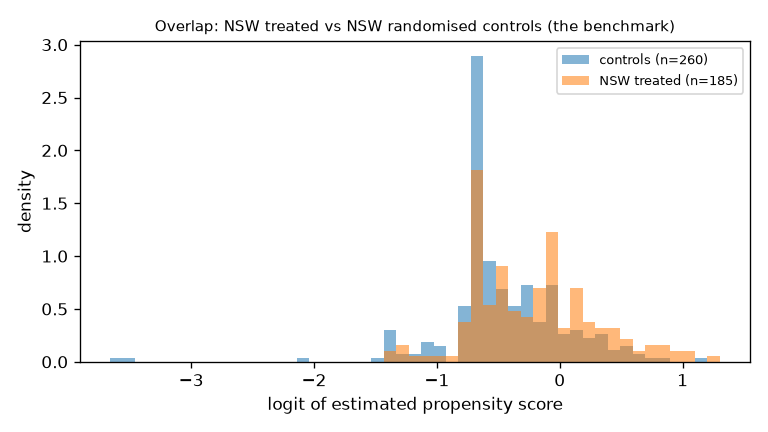

# LaLonde / NSW: observational estimators against the experimental benchmark

Generated by `python -m rie.report` from `causal/estimates.csv` and `causal/summary.json`. Do not edit by hand.

Outcome: earnings in 1978 (USD). Estimand: effect on the treated (ATT). Intervals: 95% percentile bootstrap, 500 resamples drawn separately within treated and controls, seed 20261201.

**Experimental benchmark: 1 794 USD** (bootstrap CI 497 to 3 129; Welch t CI 474 to 3 115).

| Sample | Method | Estimate | 95% CI | Bias vs benchmark | CI covers benchmark |
|---|---|---:|---:|---:|:---:|
| experimental | Difference in means | 1 794 | 497 to 3 129 | 0 | yes |
| experimental | OLS with covariates | 1 671 | 358 to 3 064 | -124 | yes |
| experimental | Propensity score matching (1 NN) | 2 376 | 0 to 3 570 | 582 | yes |
| experimental | Inverse probability weighting | 1 785 | 485 to 3 202 | -9 | yes |
| experimental | Doubly robust (AIPW) | 1 768 | 431 to 3 225 | -26 | yes |
| psid | Difference in means | -15 205 | -16 310 to -13 905 | -16 999 | no |
| psid | OLS with covariates | 4 | -1 600 to 1 632 | -1 790 | no |
| psid | Propensity score matching (1 NN) | 170 | -1 595 to 3 730 | -1 625 | yes |
| psid | Inverse probability weighting | 2 766 | 505 to 4 225 | 971 | yes |
| psid | Doubly robust (AIPW) | 2 657 | 683 to 4 191 | 862 | yes |
| cps | Difference in means | -8 498 | -9 597 to -7 242 | -10 292 | no |
| cps | OLS with covariates | 1 066 | -14 to 2 448 | -728 | yes |
| cps | Propensity score matching (1 NN) | 2 006 | -416 to 3 650 | 212 | yes |
| cps | Inverse probability weighting | 1 654 | 99 to 3 261 | -140 | yes |
| cps | Doubly robust (AIPW) | 1 479 | -6 to 3 144 | -315 | yes |

## Diagnostics

| Sample | Treated | Controls | Distinct matched controls | IPW effective n (controls) | Controls below min treated PS | max abs SMD raw | matched | IPW |
|---|---:|---:|---:|---:|---:|---:|---:|---:|
| experimental | 185 | 260 | 106 | 201.4 | 4% | 0.30 | 0.16 | 0.03 |
| psid | 185 | 2490 | 56 | 9.7 | 58% | 1.84 | 0.24 | 0.34 |
| cps | 185 | 15992 | 111 | 89.1 | 73% | 2.43 | 0.08 | 0.10 |

### Covariate balance, NSW treated vs NSW randomised controls (the benchmark)

Standardised mean difference (treated minus controls, pooled SD). Values above 0.1 in absolute size are usually read as imbalance.

| Covariate | Mean treated | Mean controls | SMD raw | SMD matched | SMD IPW |
|---|---:|---:|---:|---:|---:|
| age | 25.82 | 25.05 | 0.11 | 0.10 | -0.02 |
| education | 10.35 | 10.09 | 0.14 | -0.01 | 0.02 |
| black | 0.84 | 0.83 | 0.04 | 0.00 | -0.00 |
| hispanic | 0.06 | 0.11 | -0.17 | -0.06 | -0.01 |
| married | 0.19 | 0.15 | 0.09 | 0.16 | 0.01 |
| nodegree | 0.71 | 0.83 | -0.30 | 0.00 | 0.00 |
| re74 | 2095.57 | 2107.03 | -0.00 | 0.01 | 0.03 |
| re75 | 1532.06 | 1266.91 | 0.08 | -0.01 | 0.01 |
| u74 | 0.71 | 0.75 | -0.09 | 0.02 | -0.01 |
| u75 | 0.60 | 0.69 | -0.18 | 0.00 | 0.01 |

### Covariate balance, NSW treated vs PSID-1 survey controls (observational)

Standardised mean difference (treated minus controls, pooled SD). Values above 0.1 in absolute size are usually read as imbalance.

| Covariate | Mean treated | Mean controls | SMD raw | SMD matched | SMD IPW |
|---|---:|---:|---:|---:|---:|
| age | 25.82 | 34.85 | -1.01 | 0.24 | 0.21 |
| education | 10.35 | 12.12 | -0.68 | -0.09 | 0.10 |
| black | 0.84 | 0.25 | 1.48 | -0.06 | -0.08 |
| hispanic | 0.06 | 0.03 | 0.13 | 0.02 | -0.06 |
| married | 0.19 | 0.87 | -1.84 | 0.21 | 0.26 |
| nodegree | 0.71 | 0.30 | 0.88 | 0.12 | -0.10 |
| re74 | 2095.57 | 19428.75 | -1.72 | -0.10 | 0.07 |
| re75 | 1532.06 | 19063.34 | -1.77 | -0.14 | 0.03 |
| u74 | 0.71 | 0.09 | 1.64 | 0.22 | -0.25 |
| u75 | 0.60 | 0.10 | 1.23 | 0.20 | 0.34 |

### Covariate balance, NSW treated vs CPS-1 survey controls (observational)

Standardised mean difference (treated minus controls, pooled SD). Values above 0.1 in absolute size are usually read as imbalance.

| Covariate | Mean treated | Mean controls | SMD raw | SMD matched | SMD IPW |
|---|---:|---:|---:|---:|---:|
| age | 25.82 | 33.23 | -0.80 | -0.04 | -0.10 |
| education | 10.35 | 12.03 | -0.68 | -0.07 | 0.01 |
| black | 0.84 | 0.07 | 2.43 | -0.08 | -0.06 |
| hispanic | 0.06 | 0.07 | -0.05 | 0.02 | 0.04 |
| married | 0.19 | 0.71 | -1.23 | -0.01 | 0.04 |
| nodegree | 0.71 | 0.30 | 0.90 | 0.06 | -0.01 |
| re74 | 2095.57 | 14016.80 | -1.57 | 0.08 | 0.02 |
| re75 | 1532.06 | 13650.80 | -1.75 | 0.03 | 0.02 |
| u74 | 0.71 | 0.12 | 1.49 | 0.06 | -0.03 |
| u75 | 0.60 | 0.11 | 1.19 | 0.08 | 0.03 |

## Propensity score specification sensitivity

Same estimators, propensity score refitted with linear terms only.

| Sample | Method | Dehejia Wahba style spec | Linear spec | Shift |
|---|---|---:|---:|---:|
| psid | Propensity score matching (1 NN) | 170 | 2 168 | 1 999 |
| psid | Inverse probability weighting | 2 766 | 1 759 | -1 007 |
| psid | Doubly robust (AIPW) | 2 657 | 1 751 | -905 |
| cps | Propensity score matching (1 NN) | 2 006 | 1 756 | -250 |
| cps | Inverse probability weighting | 1 654 | 1 180 | -473 |
| cps | Doubly robust (AIPW) | 1 479 | 1 474 | -5 |

## Cross-check in R

`r/crosscheck.R` (R version 4.6.1 (2026-06-24), base `glm`, `t.test`, `survival::coxph`) reads the raw Stata files itself.

| Quantity | Python | R |
|---|---:|---:|
| Experimental benchmark (USD) | 1,794.342 | 1,794.342 |
| Welch CI lower (USD) | 474.010 | 474.010 |
| Welch CI upper (USD) | 3,114.674 | 3,114.674 |
| IPW ATT, PSID (USD) | 2,765.780 | 2,765.777 |
| IPW ATT, CPS (USD) | 1,653.900 | 1,653.898 |
| Cox HR months 0 to 12, simulated pilot | 0.657 | 0.657 |

## Reading

* The naive comparisons are badly wrong: -15 205 USD against PSID and -8 498 USD against CPS, with the wrong sign. The survey controls are older, more often married and earned far more before the programme (largest raw SMD 2.4). The comparison measures who joined, not what training did.
* Once prior earnings and demographics are adjusted for, the estimates move to 4 to 2 766 USD. OLS on PSID (4 USD) still misses: a linear outcome model extrapolates across controls who look nothing like the treated. 1 nearest neighbour matching on PSID (170 USD) also misses and moves to 2 168 USD under the linear specification.
* Propensity score methods land between 170 and 2 766 USD and every one of their intervals covers the benchmark. That is weaker evidence than it sounds: their intervals are on average 3 822 USD wide, wider than the effect itself.
* Intervals that exclude the benchmark: psid Difference in means, psid OLS with covariates, cps Difference in means.
* The results are fragile. Changing only the propensity score specification moves an estimate by up to 1 999 USD. On PSID, IPW rests on an effective sample of about 10 controls and 1 nearest neighbour matching reuses a small set of controls.
* Why the adjusted methods get close here: selection into NSW ran mostly through observed prior earnings and employment, which are in the data. Nothing guarantees that in another setting, and without the experiment we could not tell which of these estimates to believe.
* The matching interval uses the naive bootstrap, which Abadie and Imbens (2008) show is not valid for nearest neighbour matching. Treat it as indicative.
