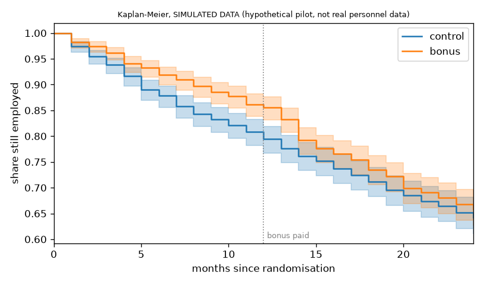

# Pre-analysis plan: retention bonus pilot (HYPOTHETICAL)

Generated by `python -m rie.report` from `design/pilot_results.json` and
`design/power_table.csv`. Do not edit by hand.

> **Everything in this plan is hypothetical.** No real pilot has been run. The staff group,
> baseline retention, bonus size and effect size are planning assumptions chosen for
> illustration. Section 9 runs the planned analysis on **simulated data** to show that the
> code works; those numbers say nothing about how a real bonus would perform.

## 1. Question and hypotheses

Does a one-off retention bonus, paid after 12 months of continued service, raise the share of
a critical staff group still employed 12 months after the offer?

* H1 (primary): the bonus raises 12 month retention.
* H2 (harm): the bonus delays exits rather than preventing them, visible as more exits right
  after payment (months 13 to 15) and a smaller gap at 24 months.
* H3 (exploratory): the effect differs by tenure band.

## 2. Population and intervention

* Eligible: all staff in the critical group in 12 units, tenure bands
  0-3y, 3-8y, 8y+.
* Intervention: written offer of 40.000 DKK, paid at month 12 if still employed.
* Control: current terms. Controls are told a bonus scheme is being evaluated and may be
  offered later (waitlist), which also limits resentment.

## 3. Randomisation

* Unit of randomisation: the individual, 1:1, stratified by unit x tenure band
  (36 strata), with a fixed, logged seed.
* Why not randomise whole units: with 12 units and an assumed intra unit
  correlation of 0.02, a cluster design with the same 1900 people could only
  detect about 11.6 percentage points (table below).
* Cost of individual randomisation: colleagues in the same unit get different offers. This
  is the main fairness risk (section 7) and must be accepted explicitly before launch.

## 4. Outcomes

* Primary: still employed 12 months after randomisation (yes or no), from HR records.
* Secondary: time to exit over 24 months; still employed at 24 months.
* Harm: exit in months 13 to 15 among those still employed at month 12; survey measure of
  intrinsic motivation and perceived fairness at months 0 and 12.

## 5. Sample size and power

Assumed control retention 80%, two sided alpha
0.05, power 0.8. To detect +5 percentage
points the pilot needs **1812 people**; the plan uses
1900, which gives a minimum detectable effect of
4.9 points. A simulation of 200 pilots of that size
under the assumed effect rejected the null in 84% of
runs.

| Total n | MDE, individual randomisation (pp) | MDE, 12 clusters, ICC 0.02 (pp) |
|---:|---:|---:|
| 600 | 8.3 | 14.3 |
| 1000 | 6.6 | 12.8 |
| 1200 | 6.1 | 12.4 |
| 1600 | 5.3 | 11.9 |
| 2000 | 4.8 | 11.5 |
| 2400 | 4.4 | 11.3 |
| 3000 | 3.9 | 11.1 |

The individual MDE inverts the sample size formula (pooled null variance). The cluster MDE
inflates the control variance by the design effect and uses t quantiles with clusters minus 2
degrees of freedom.

## 6. Analysis

* Primary: linear probability model of 12 month retention on treatment with stratum fixed
  effects, HC2 robust standard errors. Report the estimate in percentage points with its 95%
  interval, whatever its sign or p value.
* Secondary: Kaplan-Meier curves by arm; Cox model stratified by randomisation stratum,
  fitted separately for months 0 to 12 and months 13 to 24 (the payment date is a planned
  break in the hazard), plus a proportional hazards test on the full period.
* Harm: the H2 model above, same specification, among staff still employed at month 12.
* Heterogeneity: treatment x tenure band only. Labelled exploratory.
* Missing data: HR records cover everyone; survey non-response is reported by arm.
* No covariates beyond the strata are added after seeing the data.

## 7. Risks of unintended effects

| Risk | How it would show | Mitigation in the design |
|---|---|---|
| Timing: exits postponed, not prevented | spike in months 13 to 15; gap shrinks by month 24 | follow up to 24 months; harm outcome pre-specified |
| Crowding out intrinsic motivation | lower motivation score in the bonus arm | survey at 0 and 12 months |
| Fairness and resentment among controls | lower satisfaction or more exits among controls than before the pilot | waitlist promise; compare control exits with prior years |
| Spillover within units | control outcomes move with share treated in the unit | report control retention by unit share treated |
| Deadweight | most bonuses go to staff who would have stayed | cost per extra retained person reported next to the effect |

## 8. Decision rule and follow-up

* Scale up only if the lower end of the 95% interval for the primary effect is above zero,
  the harm check shows no clear post-payment spike, and the cost per extra retained person is
  below the cost of replacing one, which must be estimated separately before the pilot ends.
* Follow-up schedule: month 0 (randomisation, baseline survey), month 6 (data quality check,
  no effect estimates), month 12 (primary analysis and short decision brief), month 15 (harm
  check), month 24 (durability and final brief).

## 9. Demonstration on SIMULATED data

The simulation draws 1900 staff, assigns them with the stratified procedure above,
and generates monthly exits with a baseline monthly hazard of
0.0159, a hazard ratio of
0.73 under the bonus in months 1 to 12 (calibrated to
+5 points of 12 month retention) and a hazard
ratio of 1.8 in months 13 to 15. The analysis
does not know these values.

* Primary: 6.2 points (95% CI 2.8 to
  9.5); retention 79.4% control,
  85.5% bonus. True value 5 points.
* Harm: exits in months 13 to 15 among stayers 5.3% control,
  9.2% bonus, difference 3.8 points
  (95% CI 1.3 to 6.3).
* Retention at 24 months: 64.3% control,
  65.8% bonus (1.5
  points).
* Cox hazard ratio months 0 to 12: 0.66
  (0.53 to 0.82); months 13 to 24:
  1.24 (1.00 to
  1.55); full period 0.90
  (0.78 to 1.05).
* The proportional hazards test on the full period gives p =
  0.38, so it does not flag the reversal that is built into
  the simulation. The pre-specified split at month 12 does. A single pooled hazard ratio would
  have hidden the timing effect.

